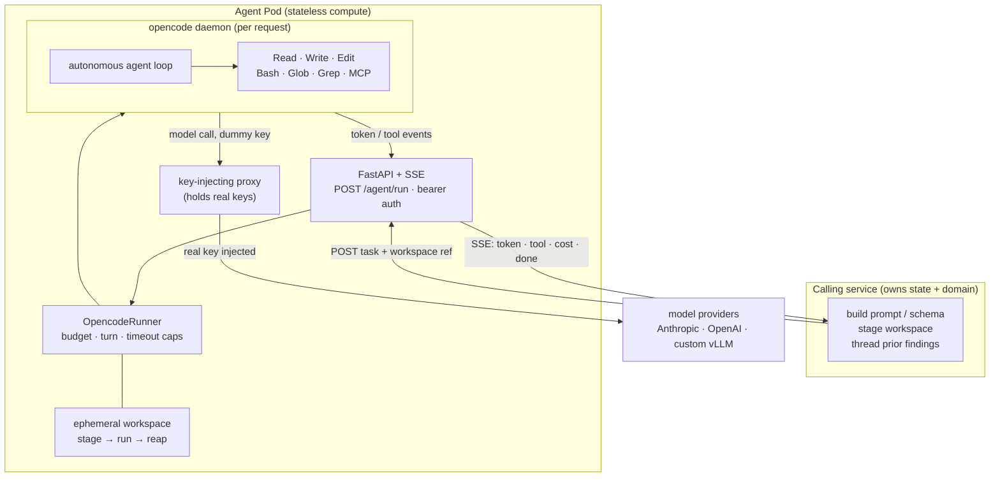
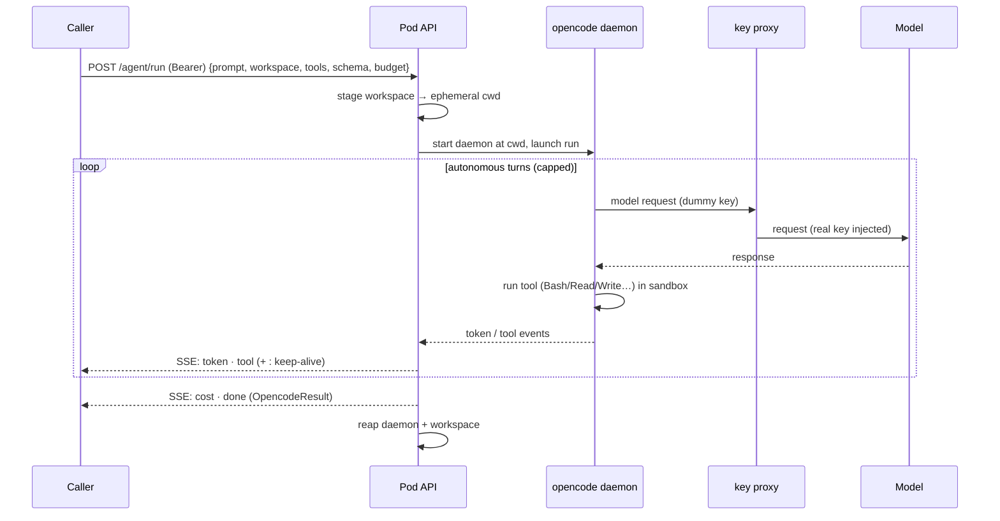

# OpenCode Agent Pod

Autonomous [opencode](https://opencode.ai) agents as a deployable HTTP service.


One request is one fully autonomous agent run: streamed trace, then a final result. The
pod owns the opencode runtime, daemon lifecycle, sandbox, and provider keys. Callers
send a task and get events back.

```
(prompt, workspace, tools, model, schema, budget)  →  streamed events  →  final result
```

## Why this exists

CLI agents like opencode and Claude Code already have the hard parts: native tools
(`Read`, `Write`, `Edit`, `Bash`, `Glob`, `Grep`), MCP, multi-turn loops, structured
output. They're built for a human at a terminal.

This pod makes that programmable. POST a task; the agent plans, runs code, reads
output, and self-corrects, streaming the trace back. The same toolset covers coding and
non-coding work (see [Who uses it](#who-uses-it)).

- One request is one self-contained run. No step-by-step approval.
- Domain stays with the caller. Prompt, tools, and staged data define the job; the pod
  has no BGP or customs knowledge of its own.
- Each run gets a throwaway workspace with real tools and MCP.
- Provider keys never leave the pod. Callers get results, not credentials.

## Stateless compute

Closer to a serverless function than a stateful service. Every request is self-contained;
any pod can serve any request; a crash loses nothing the caller can't rebuild. No session
table, no workspace cache, no conversation history in the pod. That state lives with the
caller.

| The pod owns                       | The caller owns                              |
| ---------------------------------- | -------------------------------------------- |
| opencode binary + daemon lifecycle | Caching / provisioning the workspace         |
| Agent loop: run → stream → result  | Conversation history / prior findings        |
| Ephemeral workspace + reap         | Domain logic (prompt / tools / schema)       |
| Sandbox, permissions, egress       | Building the workspace contents              |
| Provider keys (custody boundary)   | End-user identity / auth                     |

Multi-turn continuity works the way chat APIs do: the caller carries state forward.
Pass the workspace as a reference. Pass prior findings as structured output or a short
summary, not the raw transcript.

`workspace` is a pointer to data the caller already staged, not the bytes themselves:

```json
"workspace": { "source": "https://…/run-42.tgz", "mode": "ro" }
```

The pod stages that into a throwaway directory, runs the agent, and deletes it when the
run ends.

`https://` (and loopback `http://`) pulls over the network so the pod shares no
filesystem with the caller. Local `file://` / bare paths still work when both share a
host. Native `s3://` and large-data RO mounts are not built yet. An LLM with `Bash`
should not share a disk or network with a trusted backend; see [DEPLOY.md](DEPLOY.md).

## Architecture



Each request gets its own daemon and ephemeral workspace, so one caller's tools cannot
reach another's files. Both are reaped when the run ends, including on client disconnect.
Model calls leave the daemon with a dummy key and go through an in-process proxy that
injects the real key on egress.

### One run, end to end



## API

### `POST /agent/run` (bearer token required)

```jsonc
{
  "model":            "anthropic/claude-haiku-4-5-20251001", // or a custom OpenAI-compatible id
  "system_prompt":    "…",                                   // optional
  "prompt":           "…",                                   // the task
  "tools":            ["Read", "Bash", "Write"],             // from the tool registry (empty = plain inference)
  "response_schema":  { "…": "JSON Schema" },                // optional → structured output
  "reasoning_effort": "low|medium|high|max",                 // optional
  "max_budget_usd":   0.50,                                  // hard per-request breaker (clamped to pod ceiling); subagent spend counts
  "wrap_up":          false,                                 // optional; near a cap, switch tools off and ask for an answer
  "write_allow":      ["out/**"],                            // optional; only these workspace paths are writable
  "write_deny":       ["*.env"],                             // optional; never writable, even if write_allow matches
  "workspace":        { "source": "https://…/run-42.tgz", "mode": "ro" } // optional; file:// also ok on a shared host
}
```

Responds `200 text/event-stream`:

| event          | payload                                                                  |
| -------------- | ------------------------------------------------------------------------ |
| `token`        | assistant-text delta                                                     |
| `tool`         | tool call `name` / `status` / `input`, plus `output` when finished       |
| `retry`        | `reason`: `wedged` (session resumes on a fresh daemon) or `incomplete` (run restarts) |
| `: keep-alive` | comment line while idle (keeps intermediaries from timing out)           |
| `cost`         | running spend                                                            |
| `done`         | terminal `OpencodeResult` (below)                                        |

The `done` event carries:

| field               | meaning                                                                      |
| ------------------- | ---------------------------------------------------------------------------- |
| `text`              | free-text final answer                                                       |
| `structured_output` | validated object when a `response_schema` was requested                      |
| `total_cost_usd`    | aggregate spend, subagents and retried attempts included                     |
| `subagent_cost_usd` | the part of `total_cost_usd` spent by subagents                              |
| `duration_ms`       | wall-clock                                                                   |
| `num_turns`         | internal agent turns taken (subagent steps not counted)                      |
| `subtype`           | how the run ended (below)                                                    |
| `finish`            | the model's final finish reason, as opencode reports it                      |
| `wrap_up_reason`    | `budget` / `turns` / `time` when `wrap_up` fired, else null                  |
| `is_error`          | whether the caller should treat the run as failed                            |

`subtype` values:

| subtype                   | meaning                                                                  |
| ------------------------- | ------------------------------------------------------------------------ |
| `success`                 | answered                                                                 |
| `max_turns`               | hit the turn cap; output up to it stands (an error only with no structured answer) |
| `error_timeout`           | hit the wall-clock cap                                                   |
| `error_max_budget_usd`    | hit the budget                                                           |
| `error_incomplete`        | ended without the model concluding (e.g. output-length cut), even after one retry |
| `error_structured_output` | a `response_schema` run returned no valid object                         |
| `error_provider`          | the provider failed after opencode's own retries; another model may work |
| `error_transport`         | the daemon died or wedged mid-run and could not be resumed               |
| `error_session_start`     | no session could be started                                              |
| `error`                   | anything else                                                            |

A daemon that stops answering health checks mid-run is detected within about a minute,
replaced, and the same session is resumed with a continuation nudge (one retry, charged to
the run's budget).

A run with no `tools` and no `workspace` is plain inference. Add tools and a workspace
for the agent loop.

### `GET /health`

`{"status": "ok"}` once the service is up.

## Quick start

Requires the `opencode` binary on `PATH` (the Docker image pins one) and a provider key.
`AGENT_POD_TOKEN` is required: the pod fails closed (503) without it.

```bash
# Local (Python 3.12), auto-loads .env
cp env.example .env           # set AGENT_POD_TOKEN + a provider key (e.g. ANTHROPIC_API_KEY)
python -m venv .venv && .venv/bin/pip install -r requirements.txt
.venv/bin/python -m pod       # serves on :8080

# Docker
./run_pod.bash                # build + run, waits for /health
# or manually:
docker build -t opencode-agent-pod:dev .
docker run --rm -p 8080:8080 \
  -e AGENT_POD_TOKEN=$POD_TOKEN -e ANTHROPIC_API_KEY=$ANTHROPIC_API_KEY \
  opencode-agent-pod:dev
```

Smoke test:

```bash
curl -N -X POST http://localhost:8080/agent/run \
  -H "Authorization: Bearer $AGENT_POD_TOKEN" -H 'Content-Type: application/json' \
  -d '{"model": "anthropic/claude-haiku-4-5-20251001", "prompt": "Say hello."}'
```

## Integrate with your service

Your service calls the pod over HTTP; nothing else is shared. Per unit of work:

1. **Stage the workspace** (optional). Upload the files the agent should see as a `.tar.gz`
   or `.zip` to object storage and pass a pre-signed `https://` URL as `workspace.source`.
   The pod extracts it into a throwaway directory and deletes it after the run.
2. **POST one run** with your prompt, the tools it may use, and a `response_schema` if you
   want JSON back.
3. **Read the SSE stream.** Relay `token`/`tool` events to your UI if you show progress; the
   `done` event is the result.
4. **Act on the result.** Check `is_error` and `subtype`: `error_provider` and
   `error_transport` are worth retrying (another model, or the same one); `error_timeout`,
   `error_max_budget_usd` and `max_turns` will hit the same limit again unless you raise it.
5. **Carry state yourself.** For a follow-up, start a new run and put the earlier
   `structured_output` (or a summary) in the prompt. The pod keeps nothing between runs.

A minimal Python client (`pip install httpx`):

```python
import json

import httpx


def run_agent(base_url: str, token: str, body: dict) -> dict:
    """Run one agent task on the pod, printing live text, and return the final result."""
    headers = {"Authorization": f"Bearer {token}"}
    with httpx.stream(
        "POST", f"{base_url}/agent/run", json=body, headers=headers, timeout=None
    ) as resp:
        resp.raise_for_status()
        event = None
        for line in resp.iter_lines():
            if line.startswith("event: "):
                event = line.removeprefix("event: ")
            elif line.startswith("data: "):
                data = json.loads(line.removeprefix("data: "))
                if event == "token":
                    print(data["text"], end="", flush=True)
                elif event == "retry":
                    print(f"\n[pod retrying: {data['reason']}]")
                elif event == "done":
                    return data
    raise RuntimeError("stream ended without a done event")


result = run_agent(
    "http://localhost:8080",
    "<AGENT_POD_TOKEN>",
    {
        "model": "anthropic/claude-haiku-4-5-20251001",
        "prompt": "List the Python files in the workspace and say what each one does.",
        "tools": ["Read", "Glob", "Grep"],
        "workspace": {"source": "https://storage.example.com/presigned/run-42.tgz"},
        "max_budget_usd": 0.50,
    },
)
print(result["subtype"], result["total_cost_usd"])
```

Lines starting with `:` are keep-alives and can be ignored.

## Configuration

All config is `AGENT_POD_*` environment variables:

| Variable                       | Default              | Purpose                                                       |
| ------------------------------ | -------------------- | ------------------------------------------------------------- |
| `AGENT_POD_TOKEN`              | *(unset)*            | Shared bearer token, required. Unset means every request returns 503 |
| `AGENT_POD_MAX_BUDGET_USD`     | *(none)*             | Hard ceiling clamped onto every run's budget                  |
| `AGENT_POD_DEFAULT_BUDGET_USD` | *(none)*             | Budget used when a request names none                         |
| `AGENT_POD_SESSION_TIMEOUT`    | `900`                | Per-run wall-clock cap (seconds)                              |
| `AGENT_POD_MAX_TURNS`          | `30`                 | Per-run internal turn cap                                     |
| `AGENT_POD_KEEPALIVE_SECONDS`  | `15`                 | Interval between SSE keep-alive comments                      |
| `AGENT_POD_HOST` / `_PORT`     | `127.0.0.1` / `8080` | Listener bind                                                 |
| `AGENT_POD_KEY_PROXY`          | `1`                  | Key-injecting proxy on/off (leave on; off only for debugging) |
| `AGENT_POD_KEY_PROXY_HOST`     | `127.0.0.1`          | Interface the proxy binds (keep host-local)                   |

Plus:

- Provider keys (`ANTHROPIC_API_KEY`, `OPENAI_API_KEY`, …): mounted as secrets, consumed by
  the key proxy, never returned.
- `AGENT_CUSTOM_PROVIDERS`: JSON array of custom OpenAI-compatible providers (e.g. vLLM):
  `[{"name":"vllm","base_url":"http://host:8000/v1","models":["llama-bgp"]}]`.
- `AGENT_MCP_SERVERS`: JSON array of `{name, command, tools}` registering MCP servers. The
  pod bakes in none; domain tools are registered here.

## Security

Trusted-network use only. Not for the public internet. The pod runs LLM-authored code and
holds provider keys.

| Control   | What it does                                                                                         |
| --------- | ---------------------------------------------------------------------------------------------------- |
| Auth      | Bearer token required; fails closed (503) if unset                                                   |
| Spend     | Per-request budget clamped to a pod ceiling                                                          |
| Isolation | Dedicated daemon + ephemeral workspace per request; reaped on completion and on disconnect           |
| Tools     | Unlisted tools, `skill`/`question`, writes outside the workspace, and destructive or env-dumping `Bash` commands are denied; `write_allow`/`write_deny` narrow writes further |
| Keys      | Real keys live only in the in-process proxy; the daemon and its `Bash` children see a dummy key and none of the `AGENT_POD_*` settings (bearer token included) |
| Egress    | In-process key theft is closed. Blocking workspace exfil to arbitrary hosts needs a deploy-time network allowlist; see [DEPLOY.md](DEPLOY.md) |

Image build, egress `NetworkPolicy`, and scaling notes: [DEPLOY.md](DEPLOY.md).

## Who uses it

The pod itself is domain-free. These are real callers, not dependencies:

- [BGP-LLaMA](https://github.com/hyonbokan/BGP-LLaMA-webservice): routing analyst that
  executes code. The backend stages scoped BGP data as the workspace; the agent writes an
  analysis script, runs it (`Bash`), self-corrects, and streams the trace to the browser.
- [ai-customs](https://github.com/hyonbokan/ai-customs): declaration cross-checker. On 30
  real customs documents, the scripted pipeline escalated 8 valuation criticals to one
  `POST /agent/run` each; the agent resolved all 8 (5 extraction artifacts, 3 real
  under-declarations).

## Development

```bash
.venv/bin/python -m pytest tests/ -q      # unit tests (mirror agent/ and pod/)
.venv/bin/python -m ruff check .          # lint (line length 100; E,W,F,I,UP,B,C4)
.venv/bin/python -m mypy .                # types (pragmatic)
```

Conventions: Python 3.12, Ruff + mypy (see `pyproject.toml`), env-driven config. Keep the
pod domain-free: no BGP or customs vocabulary in pod code. If a change would teach the pod
what a "timerange" or "declaration" is, it belongs in a caller.

## Layout

```
opencode-agent-pod/
├── agent/              # engine: OpencodeRunner, response contract, MCP registry
│   └── opencode/       #   session client, watcher (caps, wrap-up), daemon lifecycle, provider+key map
├── pod/                # FastAPI + SSE service over the engine
│   ├── app.py          #   create_app: bearer auth, POST /agent/run, /health, lifespan drain
│   ├── service.py      #   budget resolution, runner assembly, SSE generator, per-run reap
│   ├── workspace.py    #   stage workspace-by-reference → ephemeral cwd → reap
│   ├── key_proxy.py    #   key-injecting reverse proxy: real keys never enter the daemon
│   └── schema.py       #   RunRequest + JSON-Schema response pass-through
├── tests/              # unit tests
├── Dockerfile          # deployable image (pinned opencode + the service)
├── env.example         # every setting, with defaults; copy to .env
└── DEPLOY.md           # deployment + egress hardening
```
